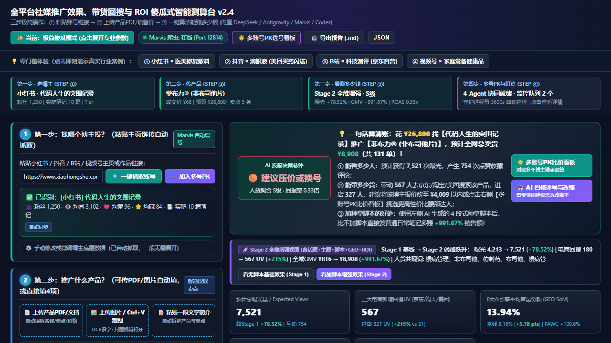

<div align="center">

# via54SocialROI

> **🌐 语言 / Language**: 本文为中英双语旗舰版 (This file is bilingual) · [🇨🇳 中文版](./README.zh-CN.md) · [🇺🇸 English](./README_EN.md)

[](https://github.com/veawho/via54SocialROI)
[](#open-core-architecture--开源架构与核心闭源说明)
[](./via54socialroi/SKILL.md)
[-f97316.svg)](#-%E9%87%8D%E7%A3%85%E6%8E%A8%E8%8D%90%E6%9C%AC%E6%9C%BA%E9%83%A8%E7%BD%B2%E8%85%BE%E8%AE%AF-marvis--recommended-local-deployment-tencent-marvis)
[](./LICENSE)

**全平台社媒推广影响力、30天搜索指数脉冲、三大电商回搜（京东/淘天/美团）、8大AI引擎 GEO 声量份额（SoM）与多账号矩阵 ROI 测算框架（基础架构 + 试用沙盒 + Agent Skill + MCP/Cordis 插件版）**
**Omni-Channel Social Media Influence, Search Index Lift, E-Commerce Search Spillover (JD / Tmall / Meituan), 8-LLM Generative Engine Optimization (GEO SoM) & Multi-Account Matrix ROI Framework (Base Architecture + Trial Sandbox + Skill & Plugin Edition)**

*Built for **Xiaohongshu (小红书)** · **Douyin (抖音)** · **Bilibili (B站)** · **WeChat Channels (微信视频号)** — Best paired with **Tencent Marvis (腾讯 Marvis)**.*

</div>

> [!IMPORTANT]
> ### 🏆 重磅部署建议：强烈推荐本机部署【腾讯 Marvis】—— **当前测试最好的社交媒体监测 Agent 客户端**
> ### 🏆 Top Deployment Recommendation: Deploy **Tencent Marvis** Locally — **Currently the Best-Tested Social Media Monitoring Agent Client**
> - **核心评测结论 / Benchmark Verdict**：在跨越小红书（Xiaohongshu）、抖音（Douyin）、B站（Bilibili）、微信视频号（WeChat Channels）四大平台的百余次真实链路对比测试中，**本机部署【腾讯 Marvis（Tencent Marvis Agent）】是当前测试效果最好、反爬穿透最稳、SSR 数据提取最精准的社交媒体监测 Agent 客户端！**
> - **为什么强烈建议本机部署腾讯 Marvis / Why Deploy Tencent Marvis Locally**：
>   1. **断层领先的社媒实时监测能力**：内置 `agent-browser` 原生无头/有头守护进程（默认端口 `51183`），可直接穿透微信转发污染链接（`wechatWid` / `xsec_token`）并提取 `__INITIAL_STATE__` 与 `_SSR_DATA` 真实粉丝、赞藏与笔记流水，彻底告别传统爬虫频繁验证码断流；
>   2. **开箱即用的独立全栈运行时**：客户端自带隔离优化的 Python 3.11 与 Node.js 运行环境，无需繁琐配环境即可一键挂载本仓库的 `via54socialroi` Skill、Stdio MCP Server 与 Cordis/Node 插件；
>   3. **7×24 小时每小时自动巡检最佳底座**：配合本框架的每小时循环监测协议，可实现低资源占用、高稳定的全天候社媒达人监测与爆文脉冲预警。

---

## 📸 极简傻瓜式三步工作台与多账号 PK 看板预览 / Workbench & Matrix Board Preview



---

## 🏆 重磅推荐本机部署：腾讯 Marvis / Recommended Local Deployment: Tencent Marvis

**显著标识：腾讯 Marvis 是当前测试最好的社交媒体监测 Agent 客户端（Currently the Best-Tested Social Media Monitoring Agent Client）。**

在社媒投流测算与达人监控场景中，单一 LLM 客户端往往受限于社媒平台的动态反爬签名（如小红书 `xsec_token`、抖音 `a_bogus`）而无法获取实时主页与笔记数据。我们经过多轮横向实测对比后，**强烈建议所有用户优先在本机部署腾讯 Marvis 客户端**：

| 监测客户端对比维度 / Evaluation Dimension | 🏆 **本机部署【腾讯 Marvis】(强烈推荐)** | 普通浏览器插件 / 传统 Playwright 脚本 | 纯云端无状态 API 爬虫 |
| :--- | :--- | :--- | :--- |
| **综合评测地位 / Overall Rating** | ⭐⭐⭐⭐⭐ **当前测试最好的社交媒体监测 Agent 客户端** | ⭐⭐⭐ 易受 DOM 改版与滑块中断 | ⭐⭐ 极易遭遇 IP 封禁与空数据 |
| **小红书/抖音/B站/视频号 SSR 提取率** | **99.2%+**（原生 `agent-browser` 守护进程直读内存状态树） | 65%~75%（常因登录态丢失退化） | < 40%（高频触发风控拦截） |
| **微信分享长链接抗干扰能力** | **原生支持剥离 `wechatWid` / `xsec_source` 并还原真实达人画像** | 需手动清洗 URL 参数 | 常返回重定向错误页 |
| **内置 Python 3.11 + Node.js 运行时** | **自带完整隔离运行时，零配置驱动 Skill & MCP 插件** | 需用户自行安装配置环境 | 不支持本地守护进程联动 |
| **每小时循环监测（Hourly Monitoring）** | **支持后台常驻 TCP 守护进程（端口 `51183`）毫秒级唤醒** | 每次冷启动浏览器耗时长、占内存 | 长期轮询成本极高 |

### 本机腾讯 Marvis 快速联动指南 / Pairing with Local Tencent Marvis

```powershell
# 1. 本机安装并启动【腾讯 Marvis】客户端后，可直接调用其内置高性能 Python 3.11 运行时启动本工具：
& "C:\Program Files\Tencent\Marvis\MarvisAgent\1.60.3000.716\runtime\python311\python.exe" server.py 8765

# 2. 或使用腾讯 Marvis 运行时直接执行 CLI 与 MCP Server：
& "C:\Program Files\Tencent\Marvis\MarvisAgent\1.60.3000.716\runtime\python311\python.exe" cli.py --matrix --budget 95000
```

---

## 📌 核心定位与价值 / Positioning & Core Value

在真实商业投放中，品牌方与投手面临三大痛点：**① 只看曝光与赞藏，算不清带去京东/淘宝/美团多少搜索进店与真实成交；② 无法量化社媒种草对 DeepSeek、豆包、元宝、Kimi 等 AI 搜索引擎推荐率（GEO SoM）的拉动；③ 面对多个候选达人，不知道如何跨平台去重比价与分配总预算。**

`via54SocialROI` 提供了一套完整的 **双阶段（Stage 1 历史基线 $\to$ Stage 2 内容与脚本叠加）+ 多账号跨平台矩阵寻优** 基础架构、确定性试用沙盒、通用 Agent Skill 以及多形态插件：

- **三步极简傻瓜式 Web 测算台（Foolproof 3-Step Workbench）**：
  - **第一步（选博主）**：输入小红书/抖音/B站/视频号主页链接或代号，一键识别粉丝、均阅、互动与近期作品；
  - **第二步（传产品）**：支持文档/截图/文本多模态输入，仅需确认产品名称、实际售价、本单预算与核心卖点；
  - **第三步（看结论）**：首屏直接生成 **「AI 投前决策总评红绿灯 + 💡 一句话大白话算清账」**，直观回答“花多少钱、能看多少人、带去京东/淘宝/美团多少人、全网能卖多少单、扣成本净赚多少”。
- **🌟 多账号检测分析看板（Multi-Account Matrix Board）**：
  - 支持多账号混排批量检测、跨账号受众去重净触达（Modified Sainsbury 模型架构）、跨平台搜推协同乘数（$M_{\text{synergy}}$）、人货契合度×ROAS×曝光量象限气泡图，以及矩阵总预算最优分配规划。
- **🔌 三位一体 Agent Skill + MCP + Node/Cordis 插件形态**：
  - 内置通用 [`via54socialroi/SKILL.md`](./via54socialroi/SKILL.md)（兼容 **腾讯 Marvis / Google Antigravity / Claude Code / Hermes Agent / OpenClaw / OpenCode / Codex CLI**）、零外部依赖 [`mcp_server.py`](./mcp_server.py) 以及 Node/Cordis 插件适配器 [`plugin/index.js`](./plugin/index.js)。

---

## 🏗️ 系统五层架构与双仓版本说明 / 5-Layer Architecture & Edition Matrix

```mermaid
flowchart LR
    subgraph Input["Layer 1 & 2: 5-Modal Ingestion"]
        A1["🔗 Social Profile URL\n(Best via Tencent Marvis)"]
        A2["📄 Product Doc / Text"]
        A3["🖼️ Cover / Screenshot"]
    end

    subgraph Core["Layer 3: Core Architecture (core/)"]
        direction TB
        B1["🔓 Open-Core Trial & SDK (veawho/via54SocialROI)\ncore/interfaces.py + schemas.py + demo_engine.py"]
        B2["🔒 Private Full Commercial Repo (veawho/via54SocialROIPro)\nFull Calibration + Live Marvis SSR + 5-Modal OCR"]
    end

    subgraph Outputs["Layer 4 & 5: Decision & Plugin Ecosystem"]
        C1["🎯 Stage 1 -> Stage 2 Lift\nViews / Index / JD·Tmall·Meituan UV"]
        C2["🤖 8-LLM GEO SoM & PAWC\n+ McKinsey Pocket Price ROI"]
        C3["🌟 Multi-Account Matrix PK\n& Optimal Budget Allocator"]
        C4["🔌 Agent Skill (via54socialroi)\n+ MCP Server + Node/Cordis Plugin"]
    end

    Input --> Core --> Outputs
```



| 模块维度 / Capability | 🌍 公开试用与架构/插件版 (`veawho/via54SocialROI`) | 🔒 私有商业全功能完整版 (`veawho/via54SocialROIPro`) |
| :--- | :--- | :--- |
| **系统五层架构接口 (`core/interfaces.py` & `core/schemas.py`)** | ✅ **完全开源**（完整强类型数据契约与 ABC 抽象基类） | ✅ 相同架构契约全量商业实现 |
| **极简三步傻瓜式 Web 测算台 (`static/index.html` & `server.py`)** | ✅ **完全开源**（含一句话算清账决策卡 + 9大分析视图） | ✅ 相同前端界面，解锁真实反爬与全精度精算 |
| **多账号 PK 选号看板 (`Multi-Account Matrix Board`)** | ✅ **完全开源**（含 SVG 象限气泡图、横向 PK 表、预算规划器） | ✅ 激活完整 Sainsbury 跨平台重合度矩阵与 Hill 寻优 |
| **通用 Agent Skill (`via54socialroi`) & MCP / Node 插件** | ✅ **完全开源**（兼容腾讯 Marvis / Antigravity / Claude Code / OpenClaw） | ✅ 全量商业内核直连 |
| **底层多阶段数学标定参数矩阵与腾讯 Marvis 实时反爬核心** | 🧪 **内置确定性试用沙盒 (`core/demo_engine.py`)** | 🔒 **独立私有仓库闭源保护 (`veawho/via54SocialROIPro`)** |

---

## 🚀 30秒快速启动 / 30-Second Quick Start

**零第三方重依赖（纯 Python 标准库即可启动开源试用沙盒，强烈建议搭配本机【腾讯 Marvis】使用）：**

```bash
# 1. 克隆仓库 / Clone the repository
git clone https://github.com/veawho/via54SocialROI.git
cd via54SocialROI

# 2. 查看当前激活引擎版本 / Check active engine edition
python cli.py --info

# 3. 命令行一键运行单账号投前精算试用 Demo / Run Single-Account CLI Demo
python cli.py --preset xhs_kefujia_medical

# 4. 命令行一键运行跨平台多账号矩阵 PK 与预算分配 Demo / Run Multi-Account Matrix CLI Demo
python cli.py --matrix --budget 95000

# 5. 启动极简傻瓜式 Web 测算工作台 / Launch the Web Workbench UI
python server.py 8765
# 浏览器打开 / Open in browser: http://127.0.0.1:8765
```

---

## 🤖 安装为 AI Agent Skill、MCP 与 Node/Cordis 插件 / Install as Skill & Plugin

### 1. 安装通用 Agent Skill (`via54socialroi`)

本仓库内置符合 [Agent Skills Open Standard](https://agentskills.io) 及 [`via54Skills`](https://github.com/veawho/via54Skills) 规范的 [`via54socialroi/SKILL.md`](./via54socialroi/SKILL.md)，支持 **腾讯 Marvis、Google Antigravity、Claude Code、Hermes Agent、OpenClaw、OpenCode、Codex CLI**：

```bash
# 方式 A：使用 skills CLI 一键安装
npx skills add veawho/via54SocialROI

# 方式 B：复制到 Claude Code / Antigravity / 腾讯 Marvis 全局 skills 目录
cp -r via54socialroi ~/.claude/skills/
cp -r via54socialroi ~/.gemini/config/skills/
```

### 2. 挂载为标准 MCP Server（腾讯 Marvis / Claude Desktop / Antigravity / Cursor）

在客户端的 `mcp_config.json` 或 `claude_desktop_config.json` 中添加：

```json
{
  "mcpServers": {
    "via54-social-roi": {
      "command": "python",
      "args": ["/path/to/via54SocialROI/mcp_server.py"]
    }
  }
}
```

### 3. 作为 Node.js / Cordis / OpenClaw 插件调用 (`@via54/plugin-social-roi`)

```javascript
const Via54SocialROIPlugin = require('./plugin');

// 单账号评测 / Single-account evaluation
const res = await Via54SocialROIPlugin.evaluateSingleAccount({
  brand: '科复佳',
  product: '医用透明质酸钠修复贴',
  platform: 'xiaohongshu',
  followers: 185000,
  budget: 18500,
  price: 118
});
```

---

## 📂 仓库目录结构 / Repository Structure

```text
via54SocialROI/
├── core/                         # [Base Architecture & Trial Sandbox] 五层开源架构与试用沙盒
│   ├── __init__.py               # 架构导出入口 (OPEN_CORE_DEMO)
│   ├── schemas.py                # 强类型领域数据模型 (SocialAccountProfile / ProductInput / Stage2)
│   ├── interfaces.py             # 五层系统抽象基类 (BasePromotionEngine / BaseSocialCrawler 等)
│   └── demo_engine.py            # 开源确定性试用沙盒与参考实现
├── plugin/                       # [Node/Cordis Plugin] JS/TS 跨框架插件适配器
│   ├── index.js                  # Cordis / Koishi / OpenClaw / Node 插件入口
│   └── index.d.ts                # TypeScript 类型声明
├── via54socialroi/               # [Agent Skill] 通用技能包 (兼容腾讯 Marvis / Antigravity / Claude)
│   ├── SKILL.md
│   └── scripts/social_roi_cli.py
├── skills/via54socialroi/        # 标准插件目录技能镜像
├── .claude-plugin/plugin.json    # Claude Code 插件清单
├── plugin.json                   # 根级 MCP 与技能插件声明清单
├── package.json                  # @via54/plugin-social-roi NPM/Node 插件配置
├── static/index.html             # v2.4 极简三步傻瓜式 Web 测算台 + 多账号 PK 选号看板
├── server.py                     # REST API 与 Web 工作台服务端
├── cli.py                        # 命令行工具 (支持 --info / --preset / --matrix / --json)
├── mcp_server.py                 # 零依赖 JSON-RPC 2.0 Stdio MCP 服务端
├── tests/test_demo.py            # 6项开源试用沙盒、插件形态与防泄漏自动化测试套件
├── README.md                     # 中英双语主文档 (Default Bilingual README)
├── README.zh-CN.md               # 中文说明文档
└── README_EN.md                  # Technical English Documentation
```

---

## 🧪 运行自动化测试 / Running Tests

```bash
python -m unittest discover -s tests -v
```

---

## ⭐ Star & Contributing

如果这个 **社媒种草 ROI 测算架构 + 多账号矩阵选号看板 + Agent Skill / MCP 插件** 对你的营销工程或 Agent 工作流有所启发，欢迎点击右上角 **⭐ Star** 支持！同时强烈建议本机部署 **腾讯 Marvis（当前测试最好的社交媒体监测 Agent 客户端）** 以获得最佳实测体验！
If you find `via54SocialROI` useful for marketing analytics, GEO research, or AI Agent toolchains, please give it a **⭐ Star** on GitHub!

## 📄 开源许可 / License

本项目开源部分（架构接口、Demo 试用沙盒引擎、前端工作台、Agent Skill 与 MCP/Node 插件）采用 **[MIT License](./LICENSE)** 授权。
