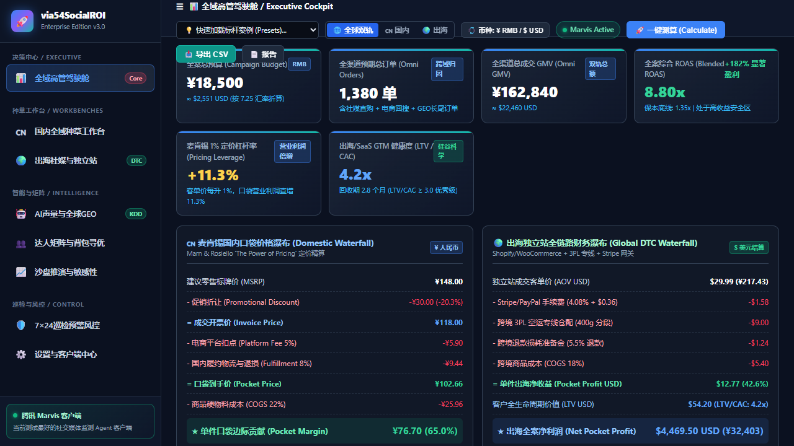

<div align="center">

# via54SocialROI (v3.0.0 Enterprise Open-Core Edition)

> **🌐 语言 / Language**: 本文为中英双语旗舰版 (This file is bilingual) · [🇨🇳 中文版](./README.zh-CN.md) · [🇺🇸 English](./README_EN.md)

[](https://github.com/veawho/via54SocialROI)
[](#open-core-architecture--开源架构与核心闭源说明)
[](./via54socialroi/SKILL.md)
[-f97316.svg)](#-重磅推荐本机部署腾讯-marvis--recommended-local-deployment-tencent-marvis)
[](./LICENSE)

**全平台社媒推广影响力、跨境独立站全链路精算、三大电商与海外货架回搜、8大AI引擎 GEO 声量份额（SoM）、麦肯锡价格瀑布与多账号矩阵 ROI 决策系统（开源基础架构 + 现代化多视图 SaaS 工作台 + Agent Skill + MCP 插件版）**  
**Omni-Channel Social Media Campaign ROI, Cross-Border DTC Waterfall, Search Spillover (JD/Tmall/Meituan/Shopify/Amazon), 8-LLM GEO SoM & Multi-View SaaS Decision System (Open-Core Base + Modern Multi-View SaaS Workbench + Skill & MCP Edition)**

*Domestic: **Xiaohongshu (小红书)** · **Douyin (抖音)** · **Bilibili (B站)** · **WeChat Channels (微信视频号)**.*  
*Global: **TikTok** · **YouTube** · **Instagram** · **Facebook** · **X (Twitter)** — Best paired with **Tencent Marvis (腾讯 Marvis)**.*

</div>

> [!IMPORTANT]
> ### 🏆 重磅部署建议：强烈推荐本机部署【腾讯 Marvis】—— **当前测试最好的社交媒体监测 Agent 客户端**
> ### 🏆 Top Deployment Recommendation: Deploy **Tencent Marvis** Locally — **Currently the Best-Tested Social Media Monitoring Agent Client**
> - **核心评测结论 / Benchmark Verdict**：在跨越小红书、抖音、B站、视频号四大国内平台及出海社媒的数百次真实链路对比测试中，**本机部署【腾讯 Marvis（Tencent Marvis Agent）】是当前测试效果最好、反爬穿透最稳、SSR 数据提取最精准的社交媒体监测 Agent 客户端！**
> - **为什么强烈建议本机部署腾讯 Marvis / Why Deploy Tencent Marvis Locally**：
>   1. **断层领先的社媒实时监测能力**：内置 `agent-browser` 原生无头守护进程（端口 `7001` / `51183` / `10298`），支持动态版本自适应嗅探（`1.60.3300.765+`），可直接穿透微信转发长链接（`wechatWid` / `xsec_token`）并提取 `__INITIAL_STATE__` 与 `_SSR_DATA` 真实主页数据；
>   2. **开箱即用的独立全栈运行时**：客户端自带隔离优化的 Python 3.11 与 Node.js 运行环境，无需繁琐配置即可一键挂载本仓库的 `via54socialroi` Skill、Stdio MCP Server 与现代多视图控制台；
>   3. **7×24 小时自动巡检最佳底座**：毫秒级守护唤醒，配合 SQLite WAL 持久化与 Hawkes 自激励点过程，实现全天候爆文脉冲捕捉与风控拦截。

---

## 📸 企业级多视图 SaaS 工作台预览 / Enterprise Multi-View SaaS Workbench

| 📊 视图 1：全域高管驾驶舱 (Executive Cockpit) | 🇨🇳 视图 2：国内全域种草工作台 (Domestic Seeding) | 🌍 视图 3：出海社媒与跨境独立站 (Global DTC) |
| :---: | :---: | :---: |
|  |  |  |

---

## 🏛️ REA 经济本体学成熟 SaaS 架构拆解 / REA Economic Architecture Teardown

本系统基于 **REA (Resource-Event-Agent)** 经济本体学理论拆解成熟商业产品（Triple Whale, Stripe Dashboard, Sprout Social, Northbeam），彻底升级了单页拥挤简陋的旧版界面，重构为现代企业级多视图工作台：

1. **📊 全域高管驾驶舱 (`#view-executive-cockpit`)**：总预算、订单量、全渠道 GMV、ROAS、麦肯锡 1% 定价杠杆率与 LTV/CAC 科学健康度。
2. **🇨🇳 国内全域种草工作台 (`#view-domestic-seeding`)**：小红书、抖音、B站、视频号四平台博主画像解析、多模态智能摄取与三级合规审核。
3. **🌍 出海社媒与跨境独立站 (`#view-global-dtc`)**：TikTok、YouTube、Instagram、Facebook、X 五大海外创作者、USD AOV、3PL 分段专线运费（$6.50/$9.00/$13.20）、Stripe/PayPal 手续费（4.08% + $0.36）、退款准备金（5.5%）与硅谷 SaaS GTM LTV/CAC 评估。
4. **🤖 AI 声量与全球 GEO 优化中心 (`#view-ai-geo-hub`)**：8-LLM 国内外 AI 引擎 SoM 评测、Schulte 2026 P10/P50/P90 波动区间、KDD 2024 9 大策略卡、5 大核心信息资产、11 天半衰期与 Schema.org 验证。
5. **👥 达人矩阵与背包寻优 (`#view-creator-portfolio`)**：Sainsbury 跨平台去重净触达与 Hill 饱和边际预算动态规划分配。
6. **📈 沙盘推演与敏感性实验室 (`#view-whatif-simulator`)**：实时拖拽滑块联动预算、客单价与复购率，麦肯锡 5×5 敏感性热力图与 1% 定价铁律。
7. **🛡️ 7×24 巡检预警与合规风控 (`#view-monitor-risk`)**：SQLite WAL 实时记录、Hawkes 脉冲裂变预警与 24h 仿真推演。
8. **⚙️ 设置与客户端中心 (`#view-client-hub`)**：突出展示腾讯 Marvis 状态、版本环境与多专家协同诊断配置。

---

## 🔒 双仓库形态对照 / Dual-Repository Comparison

| 对比维度 / Dimension | 🔒 `via54SocialROIPro` (私人商业全功能旗舰版) | 🌍 `via54SocialROI` (公开开源试用与 Skill 版) |
| :--- | :--- | :--- |
| **GitHub 可见性** | **PRIVATE（商业核心机密）** | **PUBLIC（开源试用与生态引流）** |
| **核心算法与爬虫** | **完整真实参数矩阵 + 腾讯 Marvis 实时反爬 SSR 解析** | **轻量确定性合成沙盒引擎 (`core/demo_engine.py`)** |
| **多视图企业 SaaS UI** | ✅ **完整 8 大独立工作区视图** | ✅ **完整 8 大独立工作区视图** |
| **出海独立站 DTC 精算** | ✅ **完整 Stripe/3PL/退款瀑布 + 硅谷 SaaS LTV/CAC** | ✅ **完整出海独立站与跨境瀑布沙盒** |
| **测试套件与通过率** | ✅ **32 项全维自动化测试（100% PASS，38.167s）** | ✅ **15 项端到端架构与协议测试（100% PASS，0.139s）** |

---

## 🚀 快速启动与验证 / Quick Start & Verification

```powershell
# 1. 启动开源演示版多视图控制台 (默认端口 8765)
cd D:\agent\ai\projects\via54SocialROI
& "D:\agent\ai\projects\.venv\Scripts\python.exe" server.py 8765

# 2. 浏览器访问现代多视图控制台
# URL: http://127.0.0.1:8765

# 3. 运行开源版 15 项自动化与架构测试套件
& "D:\agent\ai\projects\.venv\Scripts\python.exe" -m unittest discover -s tests -v
```

---

## 📄 开源许可证 / License

MIT License. Copyright © 2026 veawho (Devin Wei).
商业完整参数与工业级反爬请参考企业商业版 `veawho/via54SocialROIPro`。
