<div align="center">

# via54SocialROI

> **🌐 语言 / Language**: 本文为中英双语旗舰版 (This file is bilingual) · [🇨🇳 中文版](./README.zh-CN.md) · [🇺🇸 English](./README_EN.md)

[](https://github.com/veawho/via54SocialROI/actions/workflows/ci.yml)
[](https://github.com/veawho/via54SocialROI)
[](#open-core-architecture--开源架构与核心闭源说明)
[](./via54socialroi/SKILL.md)
[](./LICENSE)

**全平台社媒推广影响力、30天搜索指数脉冲、三大电商回搜（京东/淘天/美团）、8大AI引擎 GEO 声量份额（SoM）与多账号矩阵 ROI 测算框架**
**Omni-Channel Social Media Influence, Search Index Lift, E-Commerce Search Spillover (JD / Tmall / Meituan), 8-LLM Generative Engine Optimization (GEO SoM) & Multi-Account Matrix ROI Framework**

*Built for **Xiaohongshu (小红书)** · **Douyin (抖音)** · **Bilibili (B站)** · **WeChat Channels (微信视频号)** — Ships with Foolproof 3-Step Web Workbench, Universal Agent Skill (`via54socialroi`), and Zero-Dependency MCP Server.*

</div>

---

## 📸 极简傻瓜式三步工作台与多账号 PK 看板预览 / Workbench & Matrix Board Preview


---

## 📌 核心定位与价值 / Positioning & Core Value

在真实商业投放中，品牌方与投手面临三大痛点：**① 只看曝光与赞藏，算不清带去京东/淘宝/美团多少搜索进店与真实成交；② 无法量化社媒种草对 DeepSeek、豆包、元宝、Kimi 等 AI 搜索引擎推荐率（GEO SoM）的拉动；③ 面对多个候选达人，不知道如何跨平台去重比价与分配总预算。**

`via54SocialROI` 提供了一套完整的 **双阶段（Stage 1 历史基线 $\to$ Stage 2 内容与脚本叠加）+ 多账号跨平台矩阵寻优** 架构参考与交互式沙盒工具：

- **三步极简傻瓜式 Web 测算台（Foolproof 3-Step Workbench）**：
  - **第一步（选博主）**：输入小红书/抖音/B站/视频号主页链接或代号，一键识别粉丝、均阅、互动与近期作品；
  - **第二步（传产品）**：支持文档/截图/文本多模态输入，仅需确认产品名称、实际售价、本单预算与核心卖点；
  - **第三步（看结论）**：首屏直接生成 **「AI 投前决策总评红绿灯 + 💡 一句话大白话算清账」**，直观回答“花多少钱、能看多少人、带去京东/淘宝/美团多少人、全网能卖多少单、扣成本净赚多少”。
- **🌟 多账号检测分析看板（Multi-Account Matrix Board）**：
  - 支持多账号混排批量检测、跨账号受众去重净触达（Modified Sainsbury 模型架构）、跨平台搜推协同乘数（$M_{\text{synergy}}$）、人货契合度×ROAS×曝光量象限气泡图，以及矩阵总预算最优分配规划。
- **🔌 开箱即用的 Agent Skill + 标准 MCP Server**：
  - 内置通用 [`via54socialroi/SKILL.md`](./via54socialroi/SKILL.md)（兼容 **Google Antigravity / Claude Code / Hermes Agent / OpenClaw / OpenCode / Codex CLI**）与零外部依赖 [`mcp_server.py`](./mcp_server.py)，10 秒挂载至任意 AI 编码与营销智能体。

In real-world social seeding campaigns, marketers struggle with three blind spots: **(1) vanity engagement metrics disconnected from cross-shelf e-commerce search conversions (JD.com, Taobao/Tmall, Meituan O2O); (2) unquantified Generative Engine Optimization (GEO) Share of Model (SoM) across AI search engines (DeepSeek, Doubao, Yuanbao, Kimi, Perplexity, ChatGPT Search); and (3) multi-KOL portfolio overlap and budget allocation.**

`via54SocialROI` delivers a **Dual-Stage (Stage 1 Baseline $\to$ Stage 2 Script-Enhanced) + Multi-Account Matrix Portfolio** architecture reference, interactive Demo Workbench, universal Agent Skill (`via54socialroi`), and zero-dependency MCP Server.

---

## 🏗️ 系统五层架构与动态双模加载 / 5-Layer Architecture & Dual-Tier Loader

```mermaid
flowchart LR
    subgraph Input["Layer 1 & 2: 5-Modal Ingestion"]
        A1["🔗 Social Profile URL"]
        A2["📄 Product Doc / Text"]
        A3["🖼️ Cover / Screenshot"]
    end

    subgraph Loader["Layer 3: Smart Dual-Tier Engine Loader (core/__init__.py)"]
        direction TB
        B1["🔓 Open-Core Demo Engine (core/demo_engine.py)\nPublic GitHub Sandbox & SDK Reference"]
        B2["🔒 Private Pro Core (private_core/*_pro.py)\nClosed-Source Commercial Calibration & Live SSR"]
    end

    subgraph Outputs["Layer 4 & 5: Decision & Ecosystem"]
        C1["🎯 Stage 1 -> Stage 2 Lift\nViews / Index / JD·Tmall·Meituan UV"]
        C2["🤖 8-LLM GEO SoM & PAWC\n+ McKinsey Pocket Price ROI"]
        C3["🌟 Multi-Account Matrix PK\n& Optimal Budget Allocator"]
        C4["🔌 Agent Skill (via54socialroi)\n+ Stdio MCP Server"]
    end

    Input --> Loader --> Outputs
```



---

## 🔒 Open-Core 架构与核心闭源说明 / Open-Core vs. Private Pro Core

为了在分享完整工程架构、前端傻瓜式交互工作台与 Agent Skill / MCP 插件生态的同时，严格保护商业投流标定资产，本仓库采用 **Open-Core（开放架构骨架与测试沙盒 + 闭源核心算法包）** 策略：

To share the complete engineering architecture, Foolproof Web Workbench, and Agent Skill / MCP ecosystem while protecting proprietary commercial calibration assets, this repository adopts an **Open-Core** model:

| 模块维度 / Capability | 🔓 GitHub 开源社区版 (`OPEN_CORE_DEMO`) | 🔒 商业私有完整版 (`PRO_PRIVATE_CORE`) |
| :--- | :--- | :--- |
| **系统五层架构接口 (`core/interfaces.py` & `core/schemas.py`)** | ✅ **完全开源**（完整强类型数据契约与 ABC 抽象基类） | ✅ 相同架构契约无缝挂载 |
| **极简三步傻瓜式 Web 测算台 (`static/index.html` & `server.py`)** | ✅ **完全开源**（含一句话算清账决策卡 + 9大分析视图） | ✅ 相同前端界面，自动解锁实爬与全精度精算 |
| **多账号 PK 选号看板 (`Multi-Account Matrix Board`)** | ✅ **完全开源**（含 SVG 象限气泡图、横向 PK 表、预算规划器） | ✅ 激活完整 Sainsbury 跨平台重合度矩阵与 Hill 寻优 |
| **通用 Agent Skill (`via54socialroi`) & MCP Server (`mcp_server.py`)** | ✅ **完全开源**（兼容 Antigravity / Claude Code / Cursor / OpenClaw） | ✅ 自动路由至私有全精度核心 |
| **底层多阶段数学标定参数矩阵（Hawkes / Weibull / KDD'24 PAWC 权重）** | 🧪 **内置合成测试沙盒公式**（仅供流程演示与联调测试） | 🔒 **闭源私有**（位于 `.gitignore` 隔离的 `private_core/`） |
| **Marvis 实时反爬 SSR 逆向提取器（`__INITIAL_STATE__` / 实时截图）** | 🧪 **内置 4 大平台标准示例账号沙盒** | 🔒 **闭源私有**（支持任意真实链接实时无头抓取） |
| **多栏旋转扫描版 PDF 视觉重排与 WinRT OCR 启发式抽取器** | 🧪 **内置基础文本/示例结构化适配器** | 🔒 **闭源私有**（支持复杂多栏医药画册与战报截图提取） |

> 💡 **开发者扩展指南 / Extending with Custom Models**:
> 克隆本仓库后无需任何私有包即可直接运行完整的 **Web 演示工作台、CLI 与 MCP Server**。如需接入自定义预测模型，只需继承 [`core/interfaces.py`](./core/interfaces.py) 中的 `BasePromotionEngine` 与 `BaseSocialCrawler` 即可。

---

## 🚀 30秒快速启动 / 30-Second Quick Start

**零第三方重依赖（纯 Python 标准库即可启动开源演示沙盒 / Zero external dependencies required for Open-Core Demo）：**

```bash
# 1. 克隆仓库 / Clone the repository
git clone https://github.com/veawho/via54SocialROI.git
cd via54SocialROI

# 2. 查看当前激活引擎版本 / Check active engine edition
python cli.py --info

# 3. 命令行一键运行单账号投前精算 Demo / Run Single-Account CLI Demo
python cli.py --preset xhs_kefujia_medical

# 4. 命令行一键运行跨平台多账号矩阵 PK 与预算分配 Demo / Run Multi-Account Matrix CLI Demo
python cli.py --matrix --budget 95000

# 5. 启动极简傻瓜式 Web 测算工作台 / Launch the Web Workbench UI
python server.py 8765
# 浏览器打开 / Open in browser: http://127.0.0.1:8765
```

---

## 🤖 安装为 AI Agent Skill 与 MCP 插件 / Install as Agent Skill & MCP Server

### 1. 安装通用 Agent Skill (`via54socialroi`)

本仓库根目录内置符合 [Agent Skills Open Standard](https://agentskills.io) 及 [`via54Skills`](https://github.com/veawho/via54Skills) 规范的 [`via54socialroi/SKILL.md`](./via54socialroi/SKILL.md)，支持 **Google Antigravity、Claude Code、Hermes Agent、OpenClaw、OpenCode、Codex CLI**：

```bash
# 方式 A：复制到 Claude Code / Antigravity / OpenClaw 全局 skills 目录
cp -r via54socialroi ~/.claude/skills/
cp -r via54socialroi ~/.gemini/config/skills/

# 方式 B：在支持插件清单的客户端中直接加载本仓库根目录 (含 plugin.json & .claude-plugin/plugin.json)
```

### 2. 挂载为标准 MCP Server（Claude Desktop / Antigravity / Cursor / Windsurf）

在客户端的 `mcp_config.json` 或 `claude_desktop_config.json` 中添加：

```json
{
  "mcpServers": {
    "via54-social-roi": {
      "command": "python",
      "args": ["/path/to/via54SocialROI/mcp_server.py"]
    }
  }
}
```

挂载后，AI 智能体将自动获得 4 个专业投流精算工具：
- `social_roi_evaluate_single`：评估单个社媒账号推广某产品的曝光、电商回搜 UV、8 大 AI 引擎 GEO 声量与 ROI；
- `social_roi_evaluate_matrix`：跨平台多账号批量检测、去重触达、横向 PK 排名与总预算最优分配；
- `social_roi_generate_script`：按产品卖点生成 5 个垂类话题标签与 4 段式高 GEO 种草脚本；
- `social_roi_list_presets`：查看内置跨平台行业基准案例与引擎状态。

---

## 📂 仓库目录结构 / Repository Structure

```text
via54SocialROI/
├── core/                         # [Open-Core] 公开架构契约、双模加载器与沙盒演示引擎
│   ├── __init__.py               # 动态检测 private_core/ 并自动切换 PRO vs OPEN_CORE_DEMO
│   ├── schemas.py                # 强类型领域数据模型 (SocialAccountProfile / ProductInput / Stage2)
│   ├── interfaces.py             # 五层系统抽象基类 (BasePromotionEngine / BaseSocialCrawler 等)
│   └── demo_engine.py            # 开源可运行测试沙盒与参考实现 (不含商业私有标定矩阵)
├── private_core/                 # [Git-Ignored] 本地商业私有全精度引擎 (绝不上传至 GitHub)
├── static/
│   └── index.html                # v2.4 极简三步傻瓜式 Web 测算台 + 多账号 PK 选号看板
├── via54socialroi/               # 通用 Agent Skill (兼容 Antigravity / Claude / Hermes / OpenClaw)
│   └── SKILL.md
├── skills/via54socialroi/        # 标准插件目录镜像
│   └── SKILL.md
├── .claude-plugin/plugin.json    # Claude Code / 通用插件清单
├── plugin.json                   # 根级插件与 MCP 声明清单
├── server.py                     # REST API 与 Web 工作台服务端
├── cli.py                        # 命令行工具 (支持 --info / --preset / --matrix / --json)
├── mcp_server.py                 # 零依赖 JSON-RPC 2.0 Stdio MCP 服务端
├── tests/
│   └── test_demo.py              # 开源沙盒、CLI 与 MCP 协议自动化测试套件
├── README.md                     # 中英双语主文档 (Default Bilingual README)
├── README.zh-CN.md               # 中文说明文档
└── README_EN.md                  # Technical English Documentation
```

---

## 🧪 运行自动化测试 / Running Tests

```bash
python -m unittest discover -s tests -v
```

---

## ⭐ Star & Contributing

如果这个 **社媒种草 ROI 测算架构 + 多账号矩阵选号看板 + Agent Skill / MCP 插件** 对你的营销工程或 Agent 工作流有所启发，欢迎点击右上角 **⭐ Star** 支持！
If you find `via54SocialROI` useful for marketing analytics, GEO research, or AI Agent toolchains, please give it a **⭐ Star** on GitHub!

## 📄 开源许可 / License

本项目开源部分（架构接口、Demo 沙盒引擎、前端工作台、Agent Skill 与 MCP Server）采用 **[MIT License](./LICENSE)** 授权；核心商业标定参数包（`private_core/`）保留所有商业权利，不随公开仓库分发。
The Open-Core SDK, Demo Sandbox, Web Workbench, Agent Skill, and MCP Server are licensed under the **[MIT License](./LICENSE)**. All rights to the proprietary calibration core (`private_core/`) are reserved by the author.
