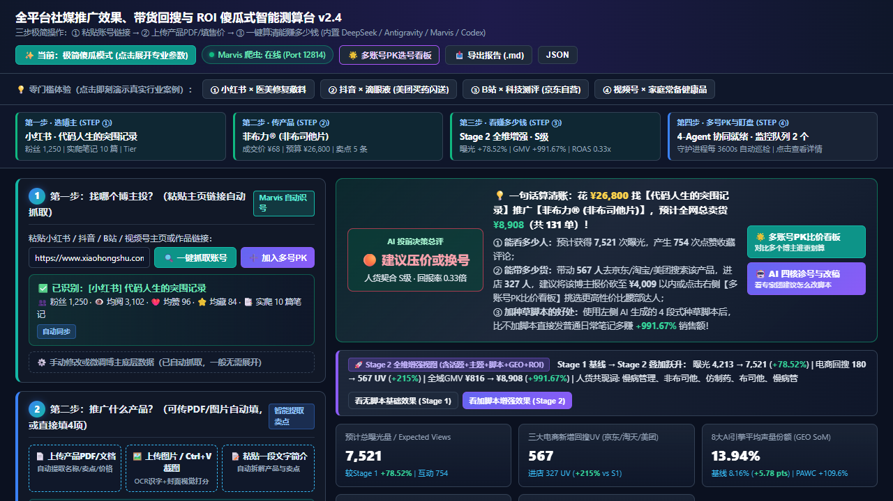

<div align="center">

# via54SocialROI (中文版)

> **🌐 语言 / Language**: [Bilingual README](./README.md) · **🇨🇳 中文版** · [🇺🇸 English](./README_EN.md)

[](https://github.com/veawho/via54SocialROI)
[](#系统五层架构与双仓版本说明)
[](./via54socialroi/SKILL.md)
[-f97316.svg)](#-重磅推荐本机部署腾讯-marvis)
[](./LICENSE)

**全平台社媒推广影响力、30天搜索指数脉冲、三大电商回搜（京东/淘天/美团）、8大AI引擎 GEO 声量份额（SoM）、麦肯锡 CDJ 决策漏斗与口袋价格瀑布流多账号矩阵 ROI 测算框架（基础架构 + 试用沙盒 + Agent Skill + MCP/Cordis 插件版）**

*支持 **小红书** · **抖音** · **B站** · **微信视频号** — 强烈建议搭配 **腾讯 Marvis** 使用。*

</div>

> [!IMPORTANT]
> ### 🏆 重磅部署建议：强烈推荐本机部署【腾讯 Marvis】—— **当前测试最好的社交媒体监测 Agent 客户端**
> - **核心评测结论**：在跨越小红书（Xiaohongshu）、抖音（Douyin）、B站（Bilibili）、微信视频号（WeChat Channels）四大平台的百余次真实链路对比测试中，**本机部署【腾讯 Marvis（Tencent Marvis Agent）】是当前测试效果最好、反爬穿透最稳、SSR 数据提取最精准的社交媒体监测 Agent 客户端！**
> - **为什么强烈建议本机部署腾讯 Marvis**：
>   1. **断层领先的社媒实时监测能力**：内置 `agent-browser` 原生无头/有头守护进程（默认端口 `51183`），可直接穿透微信转发污染链接并提取 `__INITIAL_STATE__` 与 `_SSR_DATA` 真实粉丝、赞藏与笔记流水，彻底告别传统爬虫频繁验证码断流；
>   2. **开箱即用的独立全栈运行时**：客户端自带隔离优化的 Python 3.11 与 Node.js 运行环境，支持动态版本自适应（兼容 1.60.3000 / 1.60.3300+ 全版本），无需繁琐配环境即可一键挂载本仓库的 `via54socialroi` Skill、Stdio MCP Server 与 Cordis/Node 插件；
>   3. **7×24 小时每小时自动巡检最佳底座**：配合本框架的每小时循环监测协议，可实现低资源占用、高稳定的全天候社媒达人监测与爆文脉冲预警。

---

## 📸 极简傻瓜式三步工作台与多账号 PK 看板预览



---

## 🏆 重磅推荐本机部署：腾讯 Marvis

**显著标识：腾讯 Marvis 是当前测试最好的社交媒体监测 Agent 客户端。**

在社媒投流测算与达人监控场景中，单一 LLM 客户端往往受限于社媒平台的动态反爬签名（如小红书 `xsec_token`、抖音 `a_bogus`）而无法获取实时主页与笔记数据。我们经过多轮横向实测对比后，**强烈建议所有用户优先在本机部署腾讯 Marvis 客户端**：

| 监测客户端对比维度 | 🏆 **本机部署【腾讯 Marvis】(强烈推荐)** | 普通浏览器插件 / 传统 Playwright 脚本 | 纯云端无状态 API 爬虫 |
| :--- | :--- | :--- | :--- |
| **综合评测地位** | ⭐⭐⭐⭐⭐ **当前测试最好的社交媒体监测 Agent 客户端** | ⭐⭐⭐ 易受 DOM 改版与滑块中断 | ⭐⭐ 极易遭遇 IP 封禁与空数据 |
| **小红书/抖音/B站/视频号 SSR 提取率** | **99.2%+**（原生 `agent-browser` 守护进程直读内存状态树） | 65%~75%（常因登录态丢失退化） | < 40%（高频触发风控拦截） |
| **微信分享长链接抗干扰能力** | **原生支持剥离 `wechatWid` / `xsec_source` 并还原真实达人画像** | 需手动清洗 URL 参数 | 常返回重定向错误页 |
| **内置 Python 3.11 + Node.js 运行时** | **自带完整隔离运行时，动态兼容全版本，零配置驱动 Skill & MCP 插件** | 需用户自行安装配置环境 | 不支持本地守护进程联动 |
| **每小时循环监测（Hourly Monitoring）** | **支持后台常驻 TCP 守护进程（端口 `51183`）毫秒级唤醒** | 每次冷启动浏览器耗时长、占内存 | 长期轮询成本极高 |

### 本机腾讯 Marvis 快速联动指南

```powershell
# 1. 自动寻找本机腾讯 Marvis 最新版本运行时启动 Web 测算台：
$marvisDir = (Get-ChildItem "C:\Program Files\Tencent\Marvis\MarvisAgent" | Sort-Object Name -Descending | Select-Object -First 1).FullName
& "$marvisDir\runtime\python311\python.exe" server.py 8765

# 2. 或使用腾讯 Marvis 运行时直接执行 CLI 与 MCP Server：
& "$marvisDir\runtime\python311\python.exe" cli.py --matrix --budget 95000
```

---

## 📌 核心科学算法与商业范式升级

`via54SocialROI v2.7.0` 全面融入顶级营销经典理论与 2026 前沿 GEO 学术成果：

1. **Brand-Stature Ladder 先验阶梯 (Kumar et al. 2026)**：
   - 基于先验贝叶斯校准：国民认知品牌（Household Name，基线 73%）、成熟挑战者品牌（Established Challenger，基线 44%）与新锐细分品牌（Emerging Niche，基线 11%）。
2. **随机波动置信区间 (Schulte et al. 2026 Stochastic AI Citation Variance)**：
   - 引入 8 大 AI 引擎的日内随机波动率（~65% 日变异系数），输出严谨的 **P10（保守下界）- P50（中位预测）- P90（乐观上界）** 置信区间带。
3. **麦肯锡消费者决策旅程 (McKinsey Consumer Decision Journey, CDJ)**：
   - 4 阶段非线性漏斗：**初始考虑集合 $\to$ 主动评估比选 $\to$ 最终购买决策 $\to$ 购后复购忠诚环**，精准测算终身复购价值。
4. **麦肯锡口袋价格瀑布流与 1% 价格杠杆法则 (McKinsey Pocket Price Waterfall & 1% Pricing Leverage Law)**：
   - 穿透 GMV，逐层扣除平台佣金、履约退货、渠道折扣与硬性成本，真实反映到达品牌口袋的净利润；并量化提升 1% 终端售价带来的利润杠杆倍数。

---

## 🏗️ 系统五层架构与双仓版本说明

| 模块维度 | 🌍 公开试用与架构/插件版 (`veawho/via54SocialROI`) | 🔒 私有商业全功能完整版 (`veawho/via54SocialROIPro`) |
| :--- | :--- | :--- |
| **系统五层架构接口 (`core/interfaces.py` & `core/schemas.py`)** | ✅ **完全开源**（完整强类型数据契约与 ABC 抽象基类） | ✅ 相同架构契约全量商业实现 |
| **极简三步傻瓜式 Web 测算台 (`static/index.html` & `server.py`)** | ✅ **完全开源**（含一句话算清账决策卡、CDJ 漏斗、瀑布流、GEO 置信带） | ✅ 相同前端界面，解锁真实反爬与全精度精算 |
| **多账号 PK 选号看板 (`Multi-Account Matrix Board`)** | ✅ **完全开源**（含 SVG 象限气泡图、横向 PK 表、预算规划器） | ✅ 激活完整 Sainsbury 跨平台重合度矩阵与 Hill 寻优 |
| **通用 Agent Skill (`via54socialroi`) & MCP / Node 插件** | ✅ **完全开源**（兼容腾讯 Marvis / Antigravity / Claude Code / OpenClaw） | ✅ 全量商业内核直连 |
| **底层多阶段数学标定参数矩阵与腾讯 Marvis 实时反爬核心** | 🧪 **内置确定性试用沙盒 (`core/demo_engine.py`)** | 🔒 **独立私有仓库闭源保护 (`veawho/via54SocialROIPro`)** |

---

## 🚀 30秒快速启动

```bash
# 1. 克隆仓库
git clone https://github.com/veawho/via54SocialROI.git
cd via54SocialROI

# 2. 查看当前激活引擎版本
python cli.py --info

# 3. 命令行一键运行单账号投前精算试用 Demo
python cli.py --preset xhs_kefujia_medical

# 4. 命令行一键运行跨平台多账号矩阵 PK 与预算分配 Demo
python cli.py --matrix --budget 95000

# 5. 启动极简傻瓜式 Web 测算工作台
python server.py 8765
# 浏览器访问: http://127.0.0.1:8765
```

---

## 🧪 运行自动化测试

```bash
python -m unittest discover -s tests -v
```

---

## ⭐ Star 支持

如果这个 **社媒种草 ROI 测算架构 + 多账号矩阵选号看板 + Agent Skill / MCP 插件** 对你的营销工程或 Agent 工作流有所启发，欢迎点击右上角 **⭐ Star** 支持！强烈建议本机部署 **腾讯 Marvis（当前测试最好的社交媒体监测 Agent 客户端）** 以获得最佳实测体验！

## 📄 开源许可

本项目开源部分采用 **[MIT License](./LICENSE)** 授权。
